<div align="center">

# Polygentic

**The multi-agent planning platform — research replica**

*decide first · then build*

Aligned with the Standard Agent Specification (v0.2.0)

`Next.js 16` · `React 19` · `Tailwind CSS 4` · `shadcn/ui + Radix` · `Prisma + SQLite` · `GraphQL` · `SSE`

</div>

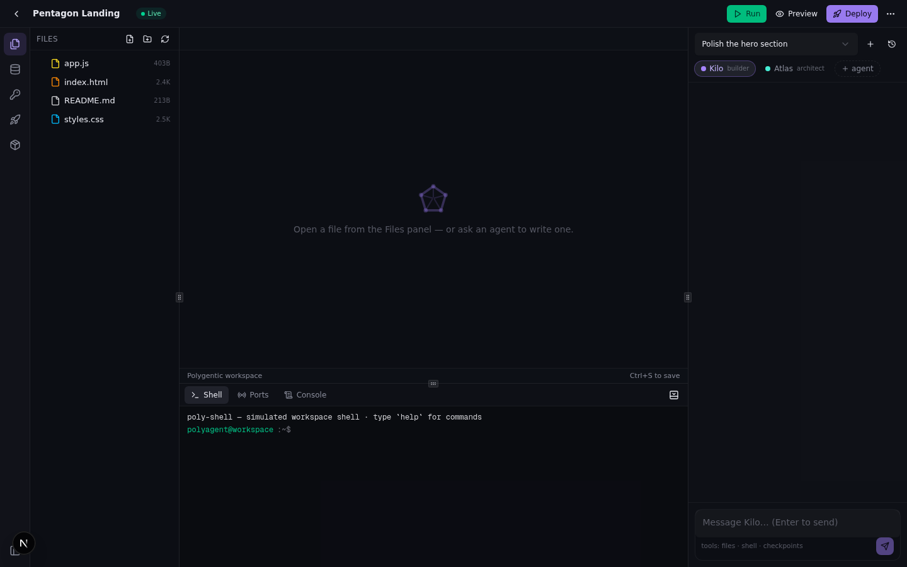

This README covers what Polygentic is, how its multi-agent pipeline works, the design system it runs on, a page-by-page specification with screenshots, and where the platform goes next.

> **Try it live:** run the app (see [Running the app](#2-running-the-app)) and sign in with the one-click demo account — `demo@polygentic.dev` / `demo1234`. It comes pre-loaded with showcase workspaces, routines, and connected integrations. To watch the whole pipeline end to end, type a prompt on Home and press **Plan with Agent**: the classifier tags it and the decision form arrives in seconds.

## Contents

1. [What Polygentic is](#1-what-polygentic-is)
2. [Running the app](#2-running-the-app)
3. [The agent pipeline](#3-the-agent-pipeline--how-a-prompt-becomes-a-verified-artifact)
4. [Design philosophy — the eight principles](#4-design-philosophy--the-eight-principles)
5. [Information architecture](#5-information-architecture)
6. [Design system](#6-design-system)
7. [Page-by-page specification](#7-page-by-page-specification)
8. [Interaction patterns](#8-interaction-patterns)
9. [States & feedback](#9-states--feedback)
10. [Accessibility](#10-accessibility)
11. [Technical architecture](#11-technical-architecture)
12. [What is real vs. simulated](#12-what-is-real-vs-simulated)
13. [Reference inventory coverage](#13-reference-inventory-coverage)
14. [Roadmap — the domain-agent platform](#14-roadmap--the-domain-agent-platform)

---

## 1. What Polygentic is

Polygentic is an **agentic planning platform**: a multi-agent, role-based system in which you prompt against a curated domain-knowledge repo, a **planner agent interviews you** through an interactive decision form, and only once every ambiguity is decided does an **editor agent build** the artifact inside a containerized workspace — with a **verifier gate** standing between "built" and "done".

It is **not** an IDE surface product. The IDE panes you see in the workspace (editor, shell, preview) are the *execution surface* — the place where agent tool calls land. They stay inert while the pipeline plans, and come alive only when the editor stage starts writing files. Interactive clarification before code execution is the platform's core mechanism for keeping agents on the rails: the interview happens before a single file exists, so no decision is ever discovered mid-build.

```
prompt ─► CLASSIFY    the classifier tags the artifact type + template
             │
             ▼
          GROUND      the knowledge repo selects the cards that inform the plan
             │
             ▼
          INTERVIEW   the planner emits a decision form — you decide
             │
             ▼
          ASSEMBLE    blueprint: directives + verifier gate
             │  you approve
             ▼
          EXECUTE     the editor writes files · auto-checkpoints after every change
             │
             ▼
          VERIFY      deterministic 5-check gate (one corrective round if it fails)
             │
             ▼
          DONE        verified artifact + report, durable and resumable
```

**The product promise, in one line: decide first, then build.** The planner asks, you decide, the editor builds, the verifier gates — and every step of the way is visible, checkpointed, and reversible.

The platform runs on a **library of specialized, domain-specific agents** that can be expanded. Today that library is the knowledge repo (17 curated cards across 10 artifact types) plus a per-stage agent routing table; each new artifact type or domain adds blueprint cards, expectation tables, and interview schemas without touching the pipeline itself. The architecture is aligned with the Standard Agent Specification for domain-specific agents — the concept-by-concept mapping is in [§11.9](#119-standard-agent-spec-alignment).

### Surfaces

| Surface | Job to be done |
|---|---|
| **Home** | Start something (prompt → the pipeline plans it) or continue something |
| **Library** | Browse community templates and the domain knowledge repo the agents plan against |
| **Routines** | Schedule recurring agent prompts ("every morning, summarize PRs") |
| **Integrations** | Connect GitHub, Slack, Notion, etc. so agents can act outside |
| **Workspace** | The execution surface: planning column + editor, shell, preview, checkpoints, deploy |
| **Settings** | The account surface: profile, credentials, account secrets, security, export, preferences |

Chrome shared by every account surface: the **workspace switcher** (Personal context; team contexts arrive with the teams tier), the **Import** action (git origin flow), and the **notification bell** (typed feed + unread badge — a plan awaiting your approval genuinely creates one).

Everything is **dark-first** — the chrome is deliberately quieter than the content it hosts.

---

## 2. Running the app

```bash
bun install          # dependencies
bun run db:push      # create/sync the SQLite schema
bun run dev          # → http://localhost:3000
bun prisma/seed.ts   # optional: reset + load the demo account & showcase data
```

**Demo account:** `demo@polygentic.dev` / `demo1234` (the "Use the demo account" button is one click; the account self-provisions on any fresh database).

**Auth is real:** email + password (scrypt-hashed), 30-day server sessions in an httpOnly cookie. Sign-up takes ~10 seconds.

**Tech:** Next.js 16 (App Router, Turbopack) · React 19 · Tailwind CSS 4 · shadcn/ui + Radix · Prisma + SQLite · GraphQL (executable schema) · SSE streaming. See [§11](#11-technical-architecture).

### Repository layout

```
src/lib/agents/models.ts       model registry: tiers, context windows, credits, capabilities
src/lib/agents/routing.ts      stage → model table, fallback chains, overrides, plan snapshot
src/lib/agents/run-stage.ts    runs a stage across its chain, then its deterministic fallback
src/lib/graphql/routing.ts     agentRouting + availableModels schema slice
docs/screenshots/              product screenshots used below
```

```bash
npm install        # dev dependencies (TypeScript, Node types)
npm test           # node --test over src/**/*.test.ts (Node ≥ 22.18, runs .ts directly)
npm run typecheck  # tsc --noEmit
```

---

## 3. The agent pipeline — how a prompt becomes a verified artifact

This is the heart of the platform. Four specialized agent stages, each with its own model, prompt, and job. The routing is exposed in the product (the `agentRouting` query feeds the stage chips you see while planning), so the design never has to invent what the system is doing.

### 3.1 Stages and model routing

| Stage | Model | Reasoning | Job |
|---|---|---|---|
| **Classifier** | `glm-4.7-air` | — | Tags the prompt with an artifact type and template (with a confidence score) |
| **Planner · Interviewer** | `glm-4.7` | thinking on | Grounds itself in the knowledge repo and emits the decision form — strictly read-only, never writes files |
| **Editor** | `glm-4.7` | — | Writes the files from the approved blueprint inside the containerized workspace |
| **Verifier** | `glm-4.7-air` | — | Runs the structural checks and the build gate (the checks themselves are deterministic — no model call) |

Every stage has a **deterministic fallback**, so a model failure degrades the plan, never the session: the classifier falls back to keyword heuristics; grounding falls back to a guaranteed baseline (type blueprint + interview craft + verification convention); the form falls back to a per-type question bank; the editor gets a verifier-driven corrective round. The stream surfaces these honestly with `planner_retry` and `planner_fallback` notices.

**How routing resolves** ([`src/lib/agents/routing.ts`](src/lib/agents/routing.ts)):

| Stage | Chain | Attempts | Requires | Then |
|---|---|---|---|---|
| Classifier | `glm-4.7-air` → `glm-4.7` | 1 | JSON mode | keyword heuristics |
| Planner · Interviewer | `glm-4.7` → `glm-4.6` | 2 | reasoning, tool use | per-type question bank |
| Editor | `glm-4.7` → `glm-4.6` | 2 | tool use | stage fails; structural gaps go to the corrective round |
| Verifier | — | 0 | — | deterministic 5-check gate |

- **Overrides** (the Home model selector, or `POLYGENTIC_MODEL_<STAGE>` env vars) go to the front of a stage's chain. An override that is unavailable or lacks a required capability is rejected and reported as a typed `RoutingIssue`; the default chain still runs.
- **Availability** filters the chain, so an outage of a model automatically skips it.
- **Attempts** walk the chain; each failed call or rejected parse is fed back into the next attempt's prompt. A cancelled request is never retried.
- **Provenance:** `snapshotRouting()` produces the JSON stored on `Plan.routing`, versioned by `ROUTING_VERSION`.
- **Providers** plug in through the `ModelClient` interface in [`src/lib/agents/run-stage.ts`](src/lib/agents/run-stage.ts).

The **Planner is sandboxed**: its system prompt forbids creating, editing, or deleting files and running commands. Its only output channel is the `submit_plan` pseudo-tool — the same tool-block protocol the editor uses, but intercepted by the plan endpoint and never executed against the workspace.

### 3.2 The durable plan state machine

Every transition is persisted before anything user-visible happens — the plan row *is* the execution engine's memory. Reload the page mid-interview and the form comes back exactly; reload after approval and the panel offers to resume the build.

```
AWAITING_DECISIONS ──submit──► DECIDED ──approve──► APPROVED ──run──► EXECUTING ──verify──► DONE
        │                         │                     │                 │
        └──────── discard ────────┴────── discard ──────┘                 │
                      (blocked once EXECUTING)                            │
                                              stream error: rollback to APPROVED
                                                  (the run can be retried)
```

| Transition | Guard | Side effects |
|---|---|---|
| → `AWAITING_DECISIONS` (plan created) | 409 if a plan for this conversation is already executing | Conversation awaits approval; "planned" feed entry; notification to the host |
| → `DECIDED` (decisions submitted) | State must be awaiting or decided | Blueprint assembled and persisted; "decided" feed entry |
| → `APPROVED` | State must be decided | "approved" feed entry — the editor is cleared to build |
| → `EXECUTING` | State must be approved (409 otherwise) | Workspace runtime flips to running; container chip appears |
| → `DONE` | Verifier passed (after at most one corrective round) | Report persisted; "verified" feed entry; completion notification |
| → `REJECTED` | Blocked while executing or done | Conversation reactivates |

Because the blueprint is re-derivable from persisted state alone, **execution is replayable without any model call**: the approved decisions and the assembled blueprint are both durable, and the editor consumes whichever survives.

### 3.3 The decision form — the interview

The planner's output is a **structured schema**, and the frontend renders it as an interactive form — never as prose to parse. The schema contract:

- **Sections** (≤ 4) each carry **questions** (≤ 4) of three kinds: `SINGLE_CHOICE` (radio), `MULTI_CHOICE` (checkboxes, with min/max selections), or `TEXT` (free answer).
- Every option carries a **label**, a **description**, and — revealed only when selected — its **implications** ("what this choice commits you to").
- Every question ships **defaults**, so the form is submittable as-is; the UI shows "X/Y decided" and pre-selects the defaults.
- A **sanitizer** bounds everything the model emits (sections, questions, options, defaults ⊆ option ids) — the form can be wrong-shaped, never dangerous.

The form's footer states its grounding: **"grounded in N knowledge cards"** — the same cards you can browse in Library → Knowledge repo. The interview is never the model's untethered opinion; it is the knowledge repo asking the questions.

### 3.4 Execution and verification

On **Approve & build**, the execution stream opens with a `container` event (image · machine class · memory — the workspace runtime descriptor), then the editor runs a bounded tool loop (≤ 6 rounds): it must act through tool calls — `create_file`, `edit_file`, `run_command` — and is explicitly forbidden from describing files in prose. After every file-mutating round the runner **auto-checkpoints** the workspace, so any build is rollback-safe by construction.

The verifier then runs a **deterministic 5-check gate** over the real workspace:

1. Entrypoint present
2. File count meets the artifact expectation
3. No TODO/lorem placeholders
4. Config parses
5. A rollback checkpoint exists

If the gate fails on structure, the verifier's exact findings are fed back to the editor for **one corrective round** (a fresh loop seeded with "create every missing file NOW"), then re-verified. The result lands as a single report card: ✓ / – / ✗ per check.

### 3.5 What the stream shows

While the pipeline runs, the agent panel shows **reasoning traces** (the planner streams its thinking; collapsible, with a live word count), **stage chips** with model and tier, the **classification card** (type, template, confidence), and **tool cards** that rise in as each call executes. Progress is evidence, not a spinner: you can watch the pipeline think, decide, and build.

---

## 4. Design philosophy — the eight principles

The interface was rebuilt around eight review principles. They are the constitution for every future change: **if a proposed change violates one of these, the change is wrong.**

### P1 — Every page answers "why did the user come here?"

Each page declares one primary job, and anything that doesn't serve that job is cut.

- **Auth** has exactly one job: get the user signed in. Two inputs, two buttons, nothing else.
- **Home** has one job: start something, or continue something. The prompt box is the hero; the project list is the memory. No dashboards, no metrics, no greeting banners beyond a quiet time-aware "Good morning."
- **Workspace** is for one project at a time — in Plan Mode the hero is the interview; while executing, the hero is the build log. The top bar carries only Run / Preview / Deploy and an overflow menu.

### P2 — Same information, one-third the noise

The original drafts had rows of buttons, text chips, and prominent dates. The compression pass:

| Before | After |
|---|---|
| Row actions: Open · Rename · Delete buttons | One ⋯ menu, revealed on row hover |
| Text chips ("html", "5 files", "live") | Icon + language dot; file/agent counts demoted to secondary line |
| Created date, big and left-aligned | Relative time ("14m"), right-aligned, 40% opacity |
| Four-field form in a 720px slide-out panel | Centered 448px modal |

### P3 — Decoration must help, or leave

Every element must help the user complete a task. The remaining "decor" is functional: the `pg-glow` radial wash anchors the brand accent on the auth screen; the pentagon mark doubles as the home button. No gradients on buttons, no drop-shadow stacking, no illustrative emptiness. Reasoning traces are collapsible and closed by default — thinking is evidence, but it is never pushed in your face.

### P4 — Tokens, not opinions

Same font sizes, same control heights, same spacing steps, same action verbs everywhere:

- **Control heights:** `size-7` (compact, 28px) · `size-8` / `h-9` (standard) · `h-10` (forms)
- **Body text:** 13–13.5px · **Secondary:** 12px · **Micro:** 10.5–11.5px · **Page title:** 20px
- **Action verbs are closed-set:** Open · Rename · Delete · Create · Deploy · Run · Stop · Connect · Disconnect · Enable · Run now · Submit · Approve · Discard

### P5 — One hero per screen

Auth → the sign-in card. Home → the prompt box. Library → the template grid (or the knowledge card grid). Routines → the routine list. Workspace → in Plan Mode, the decision form; once approved, the build log; after DONE, the verify report.

Everything else on the page is turned down: `text-muted-foreground`, smaller sizes, fewer borders. Section headers are 13px medium — never shouting.

### P6 — Design for ugly data

- Project names, secret keys, URLs, integration names: always `truncate` + `min-w-0` (ellipsize, never push layout).
- Provider icons sit in solid color circles (`bg-emerald-400 text-emerald-950`) so brand colors survive on any background.
- Long prompts are clamped in routine rows; full text lives in the editor modal.

### P7 — Empty states are the first impression

A new user's first screen after signup is an empty Home. It is designed, not accidental:

- Centered icon in a soft brand circle, one line of intent ("Nothing here yet"), one line of guidance ("Describe an idea in the box above and an agent will build the first version.")
- Routines empty state carries its own **New routine** CTA — the empty state *is* the entry point.
- The workspace files panel has its own honest empty state ("Open a file from the Files panel — or ask an agent to write one") rather than a fake tree.

### P8 — Speed is aesthetics; show that things are happening

- Every fetch paints skeletons first (project rows: 4 × 56px shimmer bars; workspace: full-panel skeleton mirroring the real layout).
- Every async button gets a `Loader2` spinner and disables during flight.
- Long operations show evidence of progress: the plan stream shows stage chips, the classification card, and the reasoning trace live; decision forms arrive with defaults pre-selected; tool cards rise in as executed; verify reports land as a single card with ✓/–/✗ per check; deploys transition `building → live` with a build log.

---

## 5. Information architecture

The app is a **single-route SPA** (`/`) that behaves like a desktop app. A Zustand store drives a three-shell model:

```
            ┌──────────────────────────────────────┐
            │     boot: splash → /api/auth/me      │
            └──────────────────┬───────────────────┘
                 no session    │    session
          ┌────────────────────┴────────────────────┐
          ▼                                         ▼
  ┌───────────────┐                 ┌───────────────────────────────┐
  │  AUTH SHELL   │                 │         ACCOUNT SHELL         │
  │ (fullscreen)  │                 │ sidebar + scrolling content   │
  └───────────────┘                 │ Home · Library · Routines ·   │
          ▲                         │ Integrations                  │
          │                         └───────────────┬───────────────┘
          │  sign out / session expiry              │ open project
          │  (graceful bounce, work preserved)      ▼
          │                                 ┌───────────────┐
          └─────────────────────────────────│   WORKSPACE   │
                                            │  (fullscreen  │
                                            │   IDE grid)   │
                                            └───────────────┘
```

### Key IA decisions

- **The Workspace deliberately does not use the account sidebar** — it's a different mode of attention (full immersion), and re-entering the account world is an explicit "Back to home."
- **Navigation is flat primary + quiet secondary:** four primary items (Home, Library, Routines, Integrations — icons + labels, current item in brand color) plus Import and Settings in a secondary group under the switcher. No sub-navigation; the Settings tree itself is server-driven (see [§7.6](#76-settings)).
- **Plan Mode is the default** in the agent panel (plan-first by default). Build Mode — the classic direct agent chat — remains one toggle away, and is what you get when iterating after DONE.
- **The workspace switcher** sits above the nav: Personal today, team contexts disabled-but-visible so the shape of the product is legible before the teams tier ships.
- **The notification bell** (bottom of the sidebar) carries the unread badge from `notificationCounts`, a typed feed (21 kinds), mark-seen / mark-all-seen, and deep links that route straight into the workspace. A plan awaiting your approval creates one; so does a completed build.
- **Mobile:** the sidebar becomes a bottom tab bar with the same four destinations + an Account tab (Settings, Security, Sign out). The workspace is desktop-first (≥1024px).
- **Session-expiry is a designed flow, not an error:** if the server session dies while a tab is open, any action triggers a "Session expired — sign in again, your work is saved" toast, a graceful bounce to Auth, and the half-typed Home prompt is re-filled after re-login. The durable plan means a half-answered interview also survives.

---

## 6. Design system

### 6.1 Color tokens

Defined once in `src/app/globals.css` as CSS variables (OKLCH), mapped into Tailwind 4 via `@theme inline`. The app is always dark; `:root` and `.dark` carry identical values.

**Surfaces (graphite-blue, hue 275)**

| Token | Value | Role |
|---|---|---|
| `--background` | `oklch(0.165 0.014 275)` | App canvas |
| `--sidebar` | `oklch(0.185 0.015 275)` | Account sidebar / rail |
| `--card` | `oklch(0.205 0.015 275)` | Cards, panels, editor chrome |
| `--popover` | `oklch(0.215 0.016 275)` | Menus, dialogs, popovers |
| `--secondary` | `oklch(0.255 0.016 275)` | Hover fills, quiet chips |
| `--border` | `oklch(1 0 0 / 8%)` | 8% white hairlines |

**Content & brand**

| Token | Value | Role |
|---|---|---|
| `--foreground` | `oklch(0.93 0.01 275)` | Primary text |
| `--muted-foreground` | `oklch(0.64 0.02 275)` | Secondary text (~64% lightness) |
| `--brand` | `oklch(0.66 0.17 293)` | Electric violet — primary actions, active nav, focus |
| `--brand-soft` | `oklch(0.75 0.12 293)` | Brand text on dark |
| `--destructive` | `oklch(0.63 0.2 25)` | Danger actions, errors |

**Functional accents** (used sparingly, always with a meaning)

| Color | Hex feel | Means |
|---|---|---|
| Emerald | `bg-emerald-400/10 text-emerald-300` | Live / success / running / verified |
| Teal | agent color | Architect agents |
| Violet | agent color | Builder agents |
| Amber | agent color | Reviewer agents |
| Rose | agent color | Critic agents |
| Orange / sky / lime / blue | file icons | html / css / js / py / json / ts |

**Chart palette:** `--chart-1..5` (violet, teal, amber, rose, blue) — reserved for data viz.

### 6.2 Typography

- **Sans:** Geist (`--font-geist-sans`) for all UI, with `cv02 cv03` alternates on.
- **Mono:** Geist Mono (`--font-geist-mono`) — shell, ports, logs, code, secret values, tool args.
- Markdown in chat (`.pg-md`) has its own prose styles: inline code chips, bordered code blocks, brand-colored links and quote bars.

| Role | Size / weight | Used for |
|---|---|---|
| Page title | 20px / 600 | "Home" (the only h1 on account pages) |
| Card title | 15px / 600 | Dialog titles, wordmark |
| Body emphasis | 13.5px / 500–600 | Row labels, buttons, nav |
| Body | 13–14.5px / 400 | Prompts, descriptions, chat |
| Secondary | 12px / 400 | Meta lines ("static · 4 files · 2 agents") |
| Micro | 10.5–11.5px | Status pills, timestamps, tab bar labels |
| Shell/code | 12.5–13px mono | Terminal, logs, ports, tool payloads |

### 6.3 Spacing, radius, elevation

- **Spacing steps:** 4px base. Common steps: 1.5 (6px) · 2 (8px) · 3 (12px) · 4 (16px) · 6 (24px) · 8 (32px). Page gutters: `px-5 sm:px-8`, vertical rhythm `py-8`.
- **Radius scale:** `--radius: 0.5rem`. Pills/rows `rounded-full` / `rounded-xl`, cards `rounded-2xl`, buttons/inputs `rounded-md`, chips `rounded-full`.
- **Elevation is depth-by-lightness, not shadow:** surfaces rise from background → sidebar → card → popover. Shadows only on overlays (`shadow-xl shadow-black/20`) — one layer, never stacked.
- **Borders are hairlines** (`border-border/70`) — panels separate by lightness step + hairline, never by heavy rules.

### 6.4 Iconography & brand

- **Icons:** Lucide only, at `size-3.5` … `size-5`. Icons in circles (`size-6…8` colored tiles) for template/language/agent identities. Every icon-only control has an `aria-label`.
- **The mark:** `PentagonMark` — five agent nodes around a host (pentagon constellation). Used at 22px in chrome, 40–44px on auth/splash. Wordmark is a set-width text lockup, `tracking-tight`.
- **Agent identity system:** name + role + color dot + initialism. The color also tints the agent's chat bubbles, tool cards and console log lines — you can see who acted without reading.
- **Stage identity (Plan Mode):** while the pipeline runs, stage chips carry the stage name with its model and tier, and a container chip (image · memory · machine class) appears during execution — the routing table, made visible.

### 6.5 Motion

| Pattern | Spec |
|---|---|
| Tool/checkpoint cards | `pg-rise` — 4px rise + fade, 220ms ease-out |
| Streaming caret | `pg-caret` — brand-colored `▍`, 1s blink |
| Terminal cursor | `pg-term-cursor` — 1.1s blink |
| Panels/dialogs/menus | Radix defaults (fade + 2px scale), 150–200ms |
| Hover states | Color-only transitions, 120–150ms — no movement |
| Skeletons | Tailwind `animate-pulse` shimmer |

**Motion rule:** motion confirms, never decorates. Nothing animates that isn't arriving, streaming, or completing.

### 6.6 Component inventory

**Foundation** (shadcn/ui + Radix, 49 primitives in `src/components/ui/`): button (6 variants × 4 sizes), input, textarea, select, dialog, alert-dialog, dropdown-menu, tooltip, resizable, scroll-area, skeleton, badge, toast, form, tabs, radio-group, checkbox, and more.

**App components** (`src/components/`)

| Area | Components |
|---|---|
| Brand | `logo.tsx` (PentagonMark, Wordmark) |
| Auth | `auth-view.tsx` |
| Shell | `app-shell.tsx`, `account-shell.tsx` |
| Home | `home-view.tsx` (PromptBox, ProjectRows, RowMenu, Rename/Delete dialogs, CreateProjectDialog) |
| Library | `library-view.tsx` (templates tab, knowledge repo tab, fork flow) |
| Routines | `routines-view.tsx` (rows, centered editor modal, live-run modal, history modal) |
| Integrations | `integrations-view.tsx` (provider grid, staged connect modal, disconnect confirm) |
| Workspace | `workspace-view.tsx` (TopBar), `left-rail.tsx`, `panels/left-panel.tsx` + files/databases/secrets/deployments/tools panels, `editor-area.tsx` (Monaco + custom theme), `bottom-pane.tsx` (shell/ports/console), `preview-panel.tsx`, `agent-panel.tsx` (plan pipeline + chat), `plan/decision-form.tsx`, `plan/plan-flow.tsx` (stage rows, reasoning trace, blueprint panel, execute trace, verify report), `settings-dialog.tsx`, `workspace-context.tsx` |

---

## 7. Page-by-page specification

### 7.0 Auth

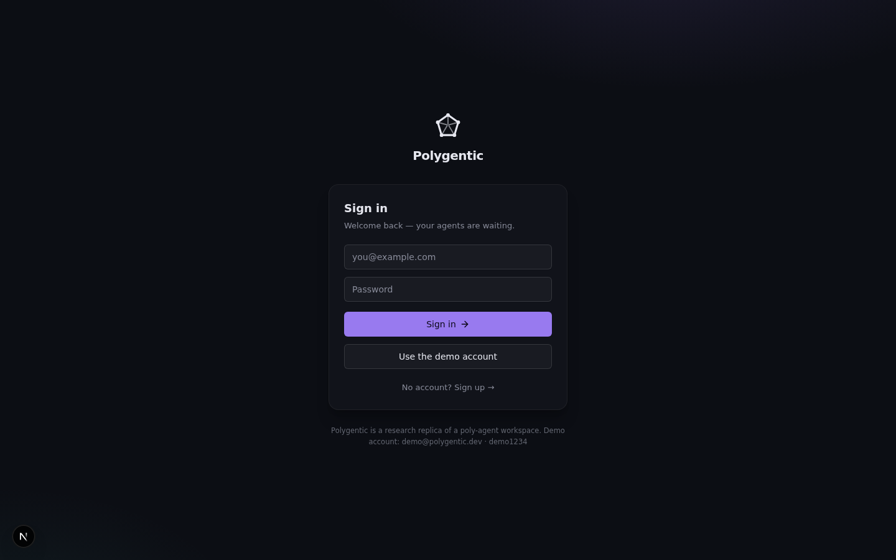

**Job:** sign in or sign up. One card, centered, over the `pg-glow` wash; mark + wordmark above.

- Login ↔ signup is one toggle ("No account? Sign up →"), never two pages.
- Validation is inline and human ("Password must be at least 8 characters."), errors in destructive red under the field.
- **"Use the demo account"** — the evaluation fast-path. Self-provisions the demo user on a fresh database.
- Button states: spinner + disable during flight; Enter submits.

### 7.1 Home

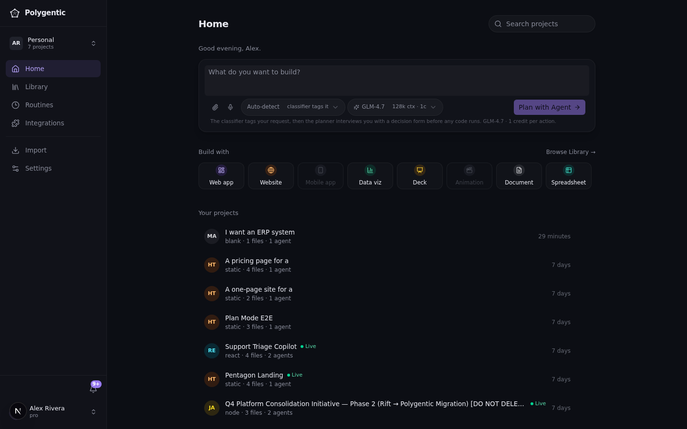

**Job:** start or continue. Layout top-to-bottom: title + search pill → greeting line → prompt box → Build-with tiles → project list → quiet credits card.

**Prompt box (the hero):** 2-row textarea, focus ring in brand. The bottom rail carries the full creation inventory, every piece server-coordinated:

- **Attach** — files become chips; small text files are inlined into the agent's brief, binaries are referenced by name/size.
- **Voice input** — the browser's own speech engine (pluggable input; graceful "unavailable" toast where the platform lacks it).
- **Output format** — Auto-detect is the default ("the classifier tags it"); the artifact-type registry (Web app / Website / Data viz / Deck / Document / Spreadsheet / Automation / API service) can be pinned instead, and Mobile app + Animation render as planned-but-disabled phase-2 tiles.
- **Model selector** — `availableModels` query (GLM-4.7 / Air / 4.6 / Max) with context window and credits-per-action in the list.
- **Plan with Agent** → bottom-right, with a one-line caption underneath: "The classifier tags your request, then the planner interviews you with a decision form before any code runs." Enter sends, Shift+Enter newlines.

**Build-with tiles:** the server-catalogued registry rendered as a scrollable tile row (36px icon circles); clicking a tile opens the create modal preselected.

**Project rows (56px):** language initialism in a tinted circle → name (+ emerald Live dot if deployed) → meta line (`template · n files · n agents`) → relative time → ⋯ menu (Open / Rename / Delete). Row hover fills `secondary/50`; the menu appears only on hover/focus.

**Credits card** (P3-quiet monetization): usage summary bar (X of quota credits) + Upgrade/Manage-plan CTA; the numbers come from the usage query, the offer copy from plan constants — server-driven, not hardcoded.

**Empty state** (see [§7.8](#78-empty-states)): dashed-border card, sparkles icon in brand circle, one sentence of guidance. Skeletons while loading; search filters by name/template live.

### 7.2 Library

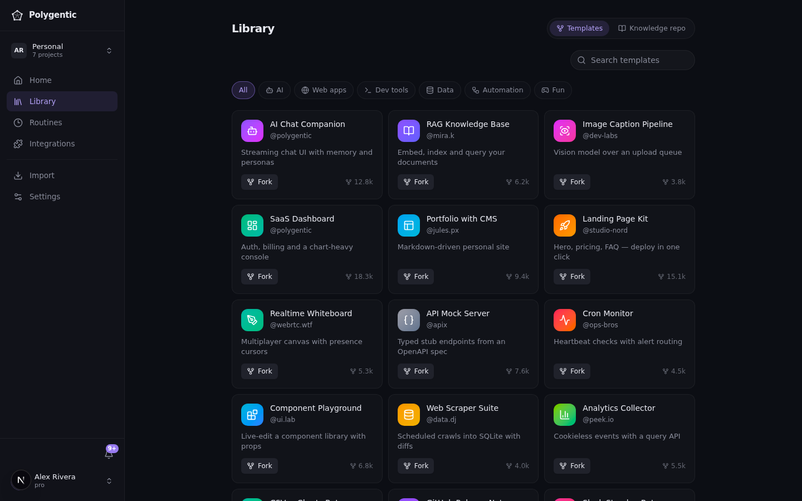

**Job:** find a starting point someone else already made — or read the domain knowledge the agents plan against. Two tabs: **Templates** and **Knowledge repo**.

**Templates tab:** search pill + 6 category chips (AI, Web apps, Dev tools, Data, Automation, Fun) filter a responsive card grid. Template card: gradient icon tile → name → tagline → author · fork count (compacted: "12.8k"). Fork = create-project modal with the template preselected. 18 seeded templates; cards are quiet by default and lift on hover.

**Knowledge repo tab:** the curated domain library behind every plan — the same cards the planner grounds itself in.

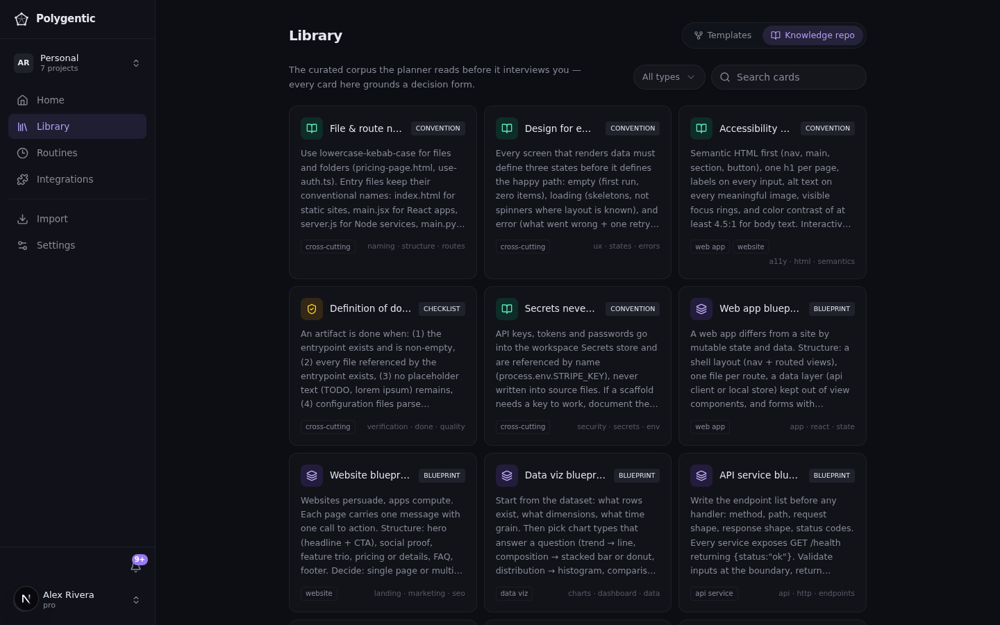

Filter by artifact type or free-text search; cards show their kind (blueprint / convention / checklist) as a tinted icon, the body, tags, and the artifact types they apply to. Cross-cutting conventions (naming, empty states, accessibility, verification, secrets) carry a badge and apply to `*` — every artifact type. The tab is the readable half of a contract: when a decision form says "grounded in 4 knowledge cards", this is where those cards live and can be audited.

### 7.3 Routines

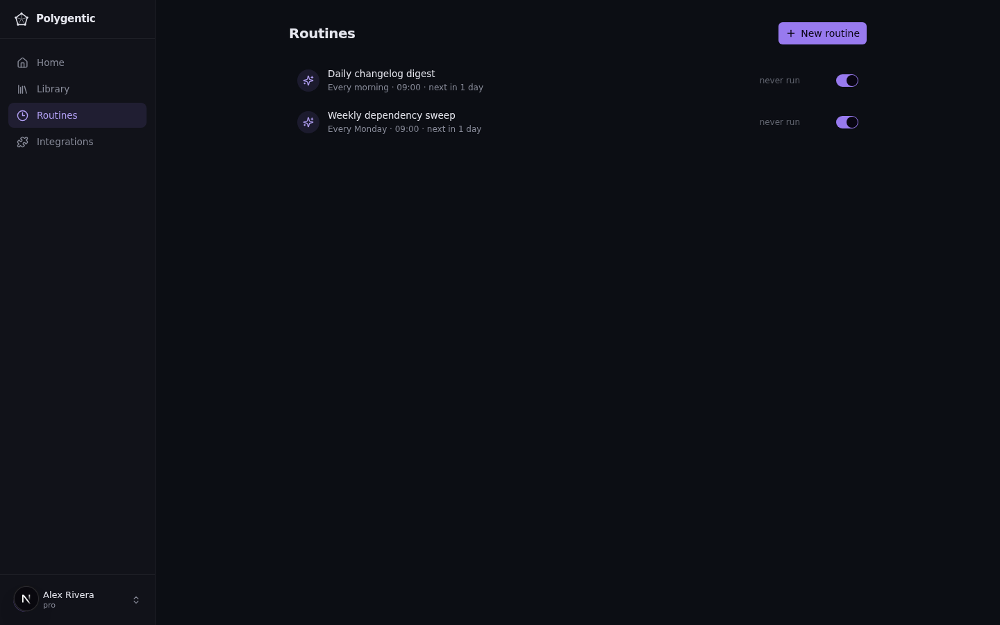

**Job:** automate recurring agent work. A quiet list of rows; **New routine** top-right.

- **Row:** icon in tinted circle → name → prompt (clamped) → schedule pill → status (Enabled toggle / Paused) → ⋯ menu (Run now / Edit / History / Delete). Meta line: run count + last run relative time.
- **Editor** is a centered modal — it's a four-field form (name, prompt, icon, schedule). Principle P2 in action.
- **Run now** opens a live modal streaming a 10-step run log over SSE ("Waking agent…", "Scanning 5 sources…", "Summary ready") — P8 evidence-of-progress.
- **History** modal lists past runs with status, duration, timestamp.

### 7.4 Integrations

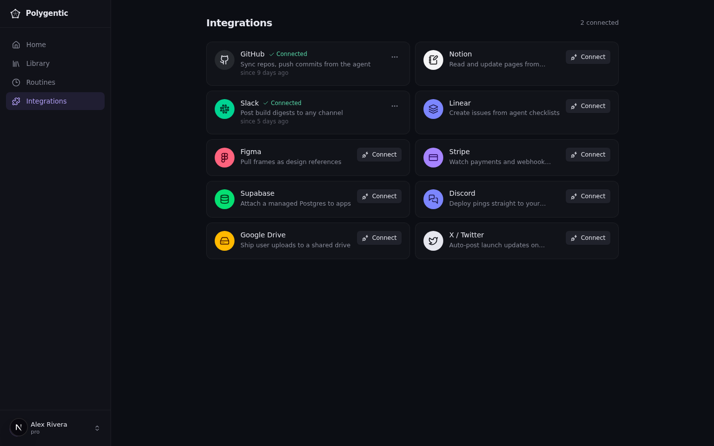

**Job:** connect the outside world. Grid of provider cards: solid-color icon circle, name, one-line description, Connect/Connected state.

- **Connect** opens a staged modal (authorizing → exchanging scopes → connected) that walks through the OAuth shape; connected cards show a timestamped badge.
- **Disconnect** asks for confirmation (it affects routines that depend on it).
- 10 providers seeded (GitHub, Slack, Notion, Linear, Figma, Stripe, Supabase, Discord, Drive, X).

### 7.5 Workspace


**Job:** turn an approved plan into a verified artifact. The workspace is two things: the **planning column** (the agent panel, where the interview and the build log live) and the **execution surface** (editor · shell · preview), which stays inert until the editor stage actually writes files.

**The planning column — five plan states, five surfaces**

| Plan state | Surface in the agent panel |
|---|---|
| `AWAITING_DECISIONS` | Decision form — schema-driven, defaults pre-selected |
| `DECIDED` | Blueprint panel — directives + verifier gate; Approve & build / Discard |
| `APPROVED` (idle) | Resume build panel — reload-safe ("Plan approved — the editor is cleared to build") |
| `EXECUTING` | Spinner banner + streaming tool cards |
| `DONE` | Verify report card — ✓/–/✗ per check |

#### Decision form

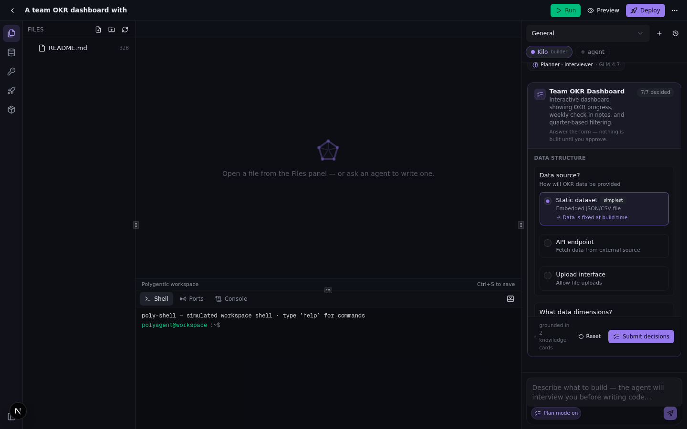

The decision form renders the planner's schema: radio groups for single-choice, checkbox cards for multi-choice (respecting max selections), textareas for free answers. Options show their description always and their implications only when selected; a counter tracks "X/Y decided"; the footer repeats the grounding ("grounded in N knowledge cards"). Submit maps typed field errors back onto the exact question. Reset restores defaults.

Above the form, the stream has already shown the classification card (type · template · confidence), the stage chips, and — if you expand it — the planner's reasoning trace.

#### Blueprint

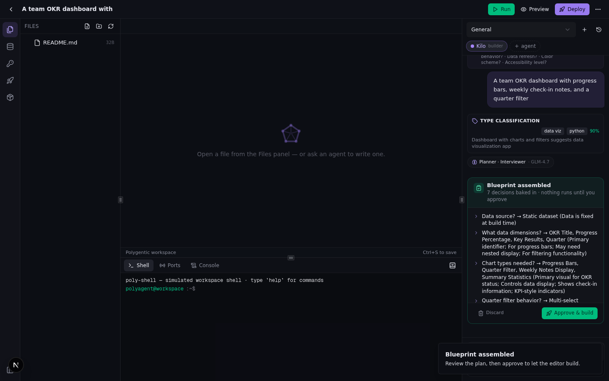

The blueprint panel assembles after you submit: the directive list ("prompt → chosen labels and their implications"), the decision log, and the verifier gate the build will be held to. One primary action — **Approve & build** — with a quiet **Discard**; the feed entry reads "Blueprint assembled — review the plan, then approve to let the editor build."

#### Verified

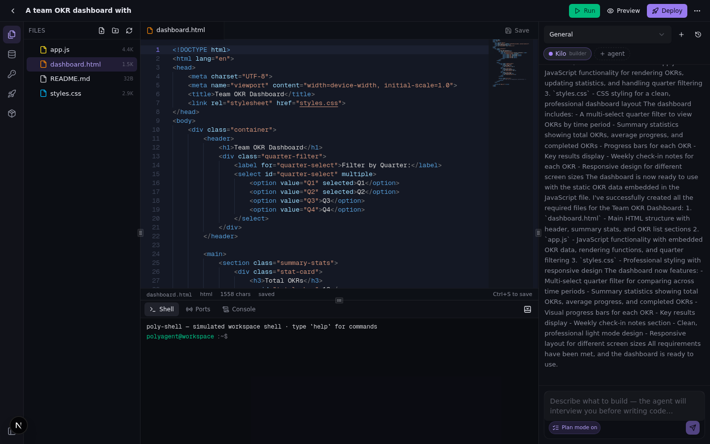

After execution, the panel lands the verify report: ✓ entrypoint (`dashboard.html` present) · ✓ files · ✓ placeholders · – config (skipped honestly: "no package.json present — not a node project") · ✓ checkpoint (the fix round's rollback point). The editor beside it holds the generated artifact; every check is a real query over the workspace, not a model's opinion.

#### The execution surface — the classic IDE grid, driven by agents

- **Grid:** 52px icon rail │ files/panel column (14–34%) │ editor + bottom pane │ preview │ agent panel — all resizable, all closable. The center panel absorbs freed space.
- **Top bar (44px):** back chevron · project name (click to rename inline) · Live badge · Run/Stop (emerald) · Preview · Deploy · ⋯ (Settings / Rename / Delete).
- **Left rail:** five panels — Files, Databases, Secrets, Deployments, Tools & packages — each icon gated by a capability (see [§11.10](#1110-capability-negotiation-bridge)): if a capability isn't granted the panel shows its degradation instead of failing.
- **Files panel:** tree with per-type colored icons, inline new file/folder, per-node ⋯ (rename/delete), size suffixes.
- **Editor:** Monaco with a custom `polygentic` theme (token colors matched to the palette), tabs with dirty-dot + close, font size / minimap / wrap in Settings.
- **Bottom pane:** tabs Shell / Ports / Console. Shell is a scripted terminal (history with ↑/↓, `help`) operating on the same DB state the agents mutate; Ports lists forwarded ports with copy-link; Console is a filterable log bus fed by every subsystem — the plan stream logs there too.

**Preview:** assembles `index.html` + `styles.css` + `app.js` into a sandboxed iframe document — real for static projects, gracefully degraded otherwise.

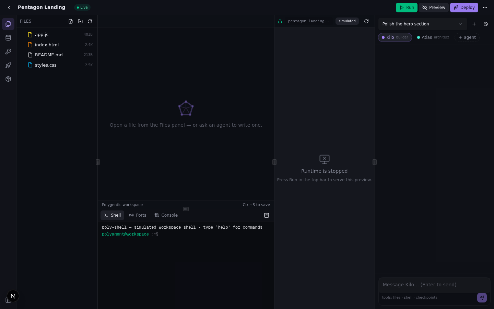

**Build Mode:** with the plan toggle off (or after DONE), the agent panel becomes the classic streaming chat — roster with color dots, markdown, tool cards with result payloads, and the "Add agent" flow (name, role, persona, color, model). Same tools, same DB; different contract — direct iteration instead of interview-first.

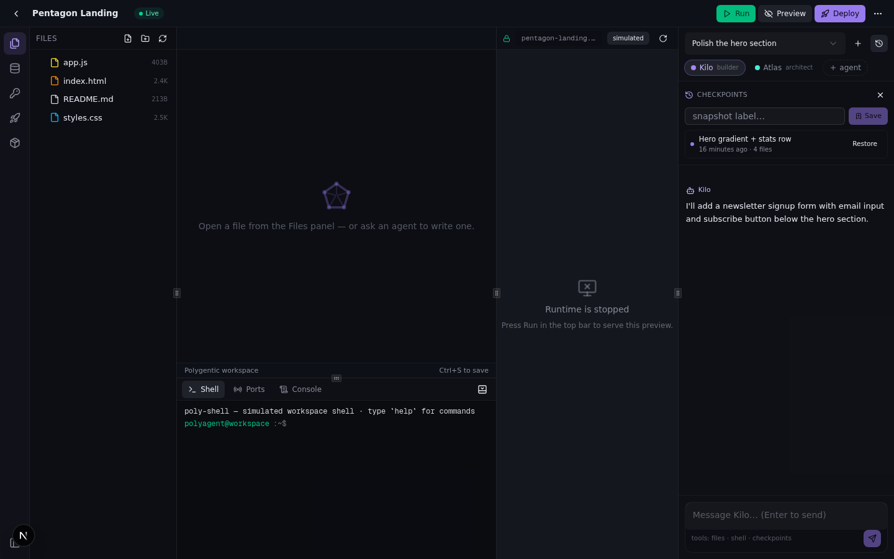

**Checkpoints:** timeline drawer over the agent panel — every file-mutating editor turn auto-snapshots; restore any checkpoint with one click (files return exactly). The verifier requires a rollback point to exist, so a verified build is always reversible by construction.

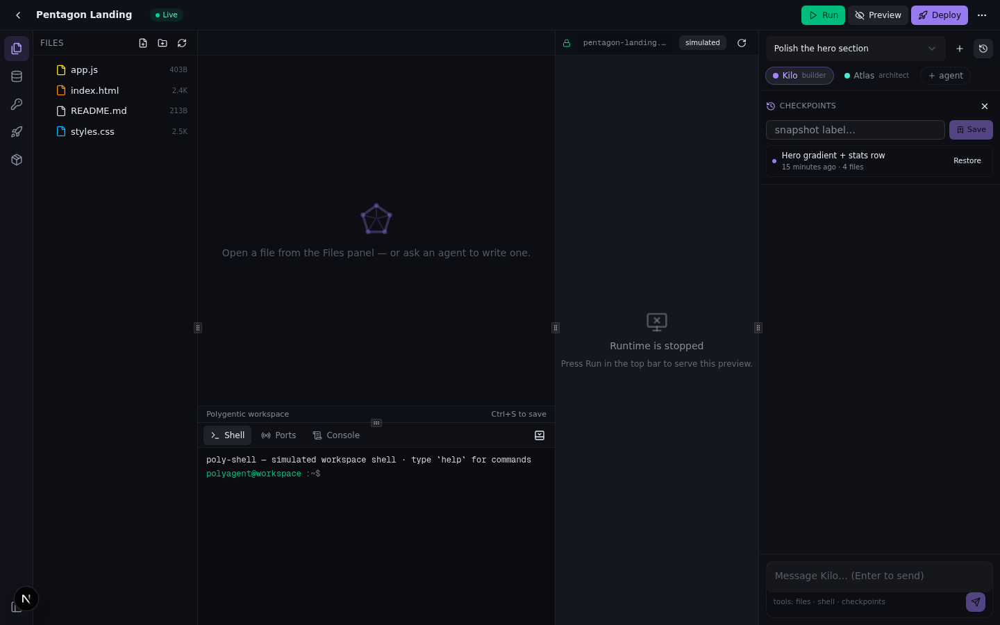

**Deploy:** confirm modal → `building` → `live` with a streamed build log; Live badge appears in the top bar and on the Home row. Deploys are also visible in the Deployments panel with full logs.

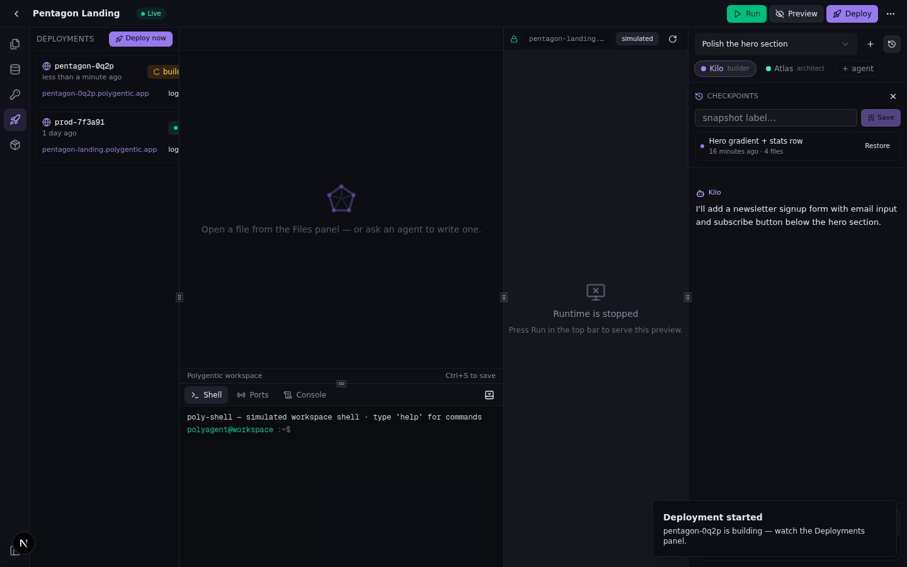

**Settings & runtime:** editor prefs (font size, minimap, wrap) + the runtime descriptor card — the negotiated tier and every capability with granted/fallback states ([§11.10](#1110-capability-negotiation-bridge)).

### 7.6 Settings

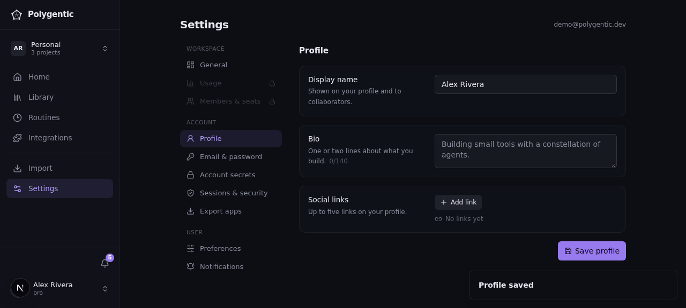

The account-level settings surface — a two-column page (server-driven section nav + content) living in the account shell. The navigation itself is a query (`settingsNavigation`), so the settings tree grows without client releases; org-gated rows arrive disabled with a lock and an honest empty state ("needs a team workspace — the data model is ready, the entitlement is not").

| Group | Section | What it does |
|---|---|---|
| Workspace | General | Personal workspace identity, credits summary, project count |
| Workspace | Usage · Members & seats | Org-gated disabled — entitlement states, not stubs |
| Account | Profile | Display name, bio with the 140-char counter, up to 5 social links |
| Account | Email & password | Verified email row; change password (revokes every other session) |
| Account | Account secrets | Account-wide secrets (write-only values) usable in any app |
| Account | Sessions & security | Sign out all other sessions; security activity feed; 2FA (planned) |
| Account | Export apps | One-click full JSON archive (profile, projects with file contents, routines, integrations) — real data portability |
| User | Preferences | Theme (dark-first), default agent instructions (server-persisted), keybindings (field live, editor tier pending) |
| User | Notifications | The typed taxonomy the bell carries + recent items |

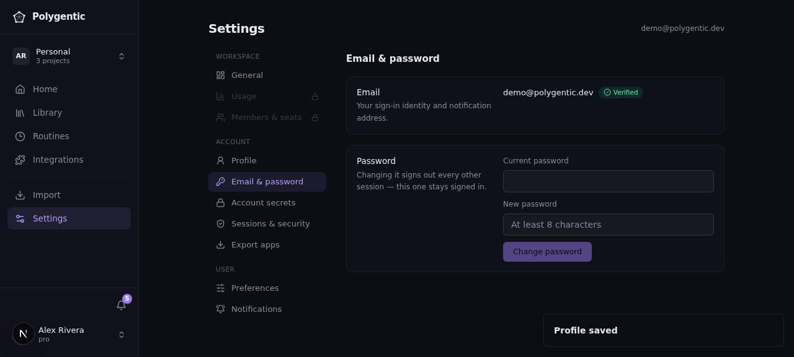

The **notification center** (bell in the sidebar) is the delivery side of the same taxonomy: unread badge mirrored from `notificationCounts`, per-kind icons, mark-seen / mark-all-seen, and deep links that route into the workspace. A plan awaiting your approval genuinely creates one; so does a verified build.

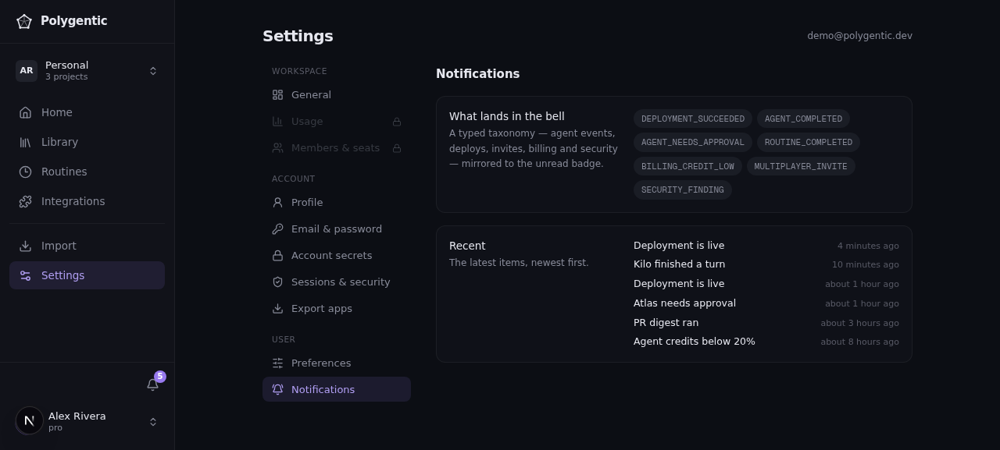

### 7.7 Modals

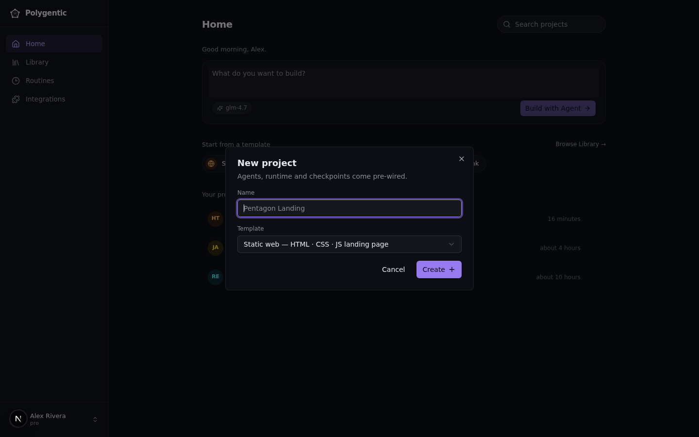

Small forms live in centered modals (`max-w-sm` – `max-w-md`), never slide-out panels: new project, rename, delete confirms, routine editor, connect handshake. Overlays dim with `black/60`; one `shadow-xl` layer; Escape/overlay-click cancels.

### 7.8 Empty states

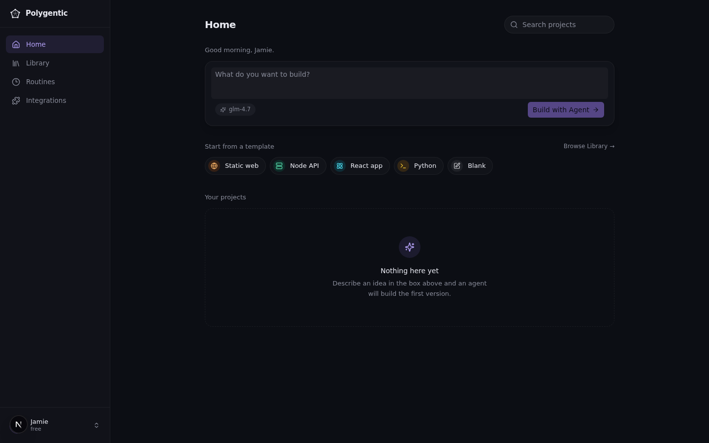

First-run Home: dashed card, icon in brand circle, one intent line, one guidance line. The prompt box above is the CTA — the empty state points at it.

---

## 8. Interaction patterns

| Pattern | Rule | Where |
|---|---|---|
| Destructive confirms | AlertDialog naming the object + consequences; destructive button in `-destructive` | Delete project/workspace/routine, disconnect integration, discard plan |
| Inline rename | Click the title → input replaces it; Enter commits, Escape cancels | Home rows, workspace top bar |
| ⋯ overflow | Row actions collapse into a hover-revealed dropdown; ≤ 3 items | Project rows, workspace, routines |
| Toast feedback | Every mutation toasts (title + detail); destructive variant for failures | Everything |
| Spinner + disable | Async buttons show `Loader2` and disable; no double-submits | All forms |
| Session expiry | Graceful bounce to auth + "your work is saved"; typed prompt restored | Global interceptor |
| Copy-on-click | URLs/secrets copy with visual confirm | Ports, secrets |
| Keyboard | Enter submits (Shift+Enter newlines), ↑/↓ shell history, Escape closes overlays | Global |
| Decision forms | Defaults pre-selected; selecting an option reveals its implications; "X/Y decided" counter; submit maps typed errors onto the exact question | Plan Mode |
| Approve & build | One primary action per plan state, never two competing CTAs; Discard is the quiet secondary and asks first | Blueprint panel |
| Reasoning traces | Collapsible, live word count, closed by default — progress evidence without noise | Plan stream |

---

## 9. States & feedback

| State | Treatment |
|---|---|
| Loading (lists) | Skeleton rows matching final geometry (4 × 56px on Home) |
| Loading (workspace) | Full-layout skeleton: top bar, rail, panel, editor, chat — shape-stable, no jump |
| Planning (stream) | Stage chips with model + tier; classification card with confidence; retry/fallback notices if the model stumbles; reasoning trace streams live and stays collapsible |
| Awaiting decisions | The form is the hero; defaults pre-selected; "grounded in N knowledge cards" footer; per-question inline errors on submit |
| Executing | Container chip (image · memory · machine class); tool cards rise in as executed; auto-checkpoint cards with file counts |
| Streaming | Token-by-token text + blinking caret; tool cards rise in as executed |
| Progress | Deploy `building → live`, routine step-log, checkpoint cards with file counts, verify report with ✓/–/✗ per check |
| Empty | Designed empty states with guidance (P7) |
| Error | Inline field errors (auth, decision forms), destructive toasts (mutations), full-screen workspace fallback with "Back to home"; a failed execution rolls the plan back to `APPROVED` so it can be retried |
| Degradation | Capability-gated panels swap in their fallback treatment (e.g. read-only preview card) instead of erroring; model failures degrade to deterministic fallbacks, never dead ends |

---

## 10. Accessibility

- 120 `aria-*` attributes across app components; every icon-only control is labeled.
- Semantic landmarks: `nav`, `main`, `header`, `aria-current="page"` on active nav.
- Radix primitives give dialogs/menus focus trapping, typeahead and Escape handling for free.
- Decision forms render as labeled radio groups and checkbox groups with help text; the selected state is never color-only (a check plus the revealed implications text), and errors are announced inline per question.
- **Contrast:** foreground 0.93 vs background 0.165 lightness (~15:1); muted-foreground ≥ 4.5:1 on all surfaces; destructive and brand text tested on their fills.
- **Visible focus:** `outline-ring/50` ring on all interactives; focus-visible is never suppressed.
- **`prefers-reduced-motion`:** transitions are color-only (safe by default); `pg-rise`/blink are candidates for a future reduced-motion guard.
- **Full keyboard path:** nav → rows (Tab) → actions (Enter) → menus (Escape) → shell history (↑/↓).

---

## 11. Technical architecture

Just enough for design collaboration — see the code for details.

### 11.1 Stack

- Next.js 16 (App Router, Turbopack) · React 19 · TypeScript
- Tailwind CSS 4 + shadcn/ui (Radix) · Zustand (client state)
- Prisma ORM + SQLite (`db/custom.db`) ← real persistence, incl. the plan state machine
- GraphQL (`graphql` + `@graphql-tools`) ← executable schema, fail-fast validation, typed payloads
- SSE (`text/event-stream`) ← plan stream, execute stream, agent chat, routine runs
- Monaco editor (self-hosted) ← workspace editing

### 11.2 Data model (Prisma)

```
User ─< Session
User ─< Project ─< FileNode · Agent ─< Message >─ Conversation ─1—1 Plan ─< PlanDecision
               ─< Checkpoint (snapshot JSON) · Deployment · DbInstance ─< DbTable
               ─< Secret · Pkg · PortInfo · Task · Workspace (runtime state + resource envelope)
User ─< Routine ─< RoutineRun
User ─< Integration
User ─< Notification (typed 21-kind taxonomy) · AccountSecret (write-only values)
      · UsageEvent (credit ledger by domain) · GatewayToken
```

**The planning additions:**

- **`Plan`** — one-to-one with a conversation. Carries the durable state (`AWAITING_DECISIONS → DECIDED → APPROVED → EXECUTING → DONE`, plus `REJECTED`), the classification (artifact type, template, confidence, note), the form itself (`sections` JSON), the assembled `blueprint` JSON, the grounding provenance (`knowledgeCardIds`), the model-routing snapshot (`routing`), and the verifier `report`.
- **`PlanDecision`** — one row per answered question (`questionId`, `optionIds`, `textValue`), upserted on `planId_questionId` so re-submitting is idempotent.

Knowledge cards and the routing table are **code-versioned, not rows** — the plan row snapshots their ids for provenance, so a plan always records which library version grounded it.

### 11.3 The agent runtime

- **Tools (8):** `list_files`, `read_file`, `create_file`, `edit_file`, `delete_file`, `run_command`, `create_checkpoint`, `submit_plan` — invoked through a fenced `<<<TOOL {json} TOOL>>>` block protocol with lenient fallbacks, and a stream guard that holds back text at potential tool-call starts so tool JSON never leaks into the visible stream.
- **Runner:** a bounded model → tool → model loop (≤ 6 rounds for the editor, ≤ 5 for a corrective round, ≤ 4 in Build Mode) with per-stage model selection and tool allowlists. After any file-mutating round it auto-checkpoints the workspace.
- **Prompts:** per-stage system prompts — the classifier's ("reply with exactly one JSON object"), the planner's (sandbox declaration + knowledge cards + the `submit_plan` contract), the editor's (blueprint directives + definition-of-done + "never describe files in prose — every file must be a `create_file` tool call").
- **Routing:** a fixed stage → model table with per-stage fallback chains (see [§3.1](#31-stages-and-model-routing) and [`src/lib/agents/routing.ts`](src/lib/agents/routing.ts)), exposed through the `agentRouting` query and snapshotted onto every plan.
- **Shell:** the terminal pane runs against the same DB state the agents mutate (`ls`, `tree`, `cat`, `npm`, `git status/log` — checkpoints render as pseudo-commits), so the shell, the file tree, and the agents can never disagree.

### 11.4 The knowledge repo

17 curated cards in three kinds — **blueprints** (one per artifact type: web app, website, data viz, API service, document, deck, spreadsheet, automation, mobile, animation), **conventions** (cross-cutting: naming, empty states, accessibility, verification, secrets — they apply to `*`), and **planner craft** (how to interview, how to scope). Retrieval is a scored selection (type match + tag hits), capped at 6 cards, with a guaranteed baseline (type blueprint + interview craft + verification convention) so grounding never comes back empty. Each artifact type also carries an **expectation table** (entrypoint, entry files, minimum file count) that becomes the verifier's gate and the template scaffold.

### 11.5 The plan-schema contract

The planner must emit exactly one `submit_plan` block containing a `PlanDocument`: sections → questions (`SINGLE_CHOICE` / `MULTI_CHOICE` / `TEXT`) → options (label, description, implications, badge) with defaults and selection bounds. A sanitizer enforces the shape (≤ 4 sections, ≤ 4 questions, ≤ 5 options, defaults ⊆ option ids) and reports its issues — the first failure triggers a retry with the issues fed back; the second falls back to the per-type question bank. On submit, `assembleBlueprint` composes the build handoff **without any model call**: directives (prompt → chosen labels + implications), the decision log, and the five verification checks derived from the artifact's expectation table. Pure functions, replayable from durable state alone.

### 11.6 Durable execution

The `Plan` row is the state machine; every transition is a guarded, persisted update (see [§3.2](#32-the-durable-plan-state-machine) for the transition table). **Resume is a re-hydrate, not a reconstruction:** on any page load the panel fetches the plan and renders the surface for its state — including the "resume the build" panel after a reload mid-approval. Execution re-derives the blueprint from the persisted blueprint JSON, or from the `PlanDecision` rows if the snapshot is missing — no LLM calls involved. Checkpoints (full file-list JSON snapshots) are created by tool call, automatically after file-mutating rounds, or manually — and restored by rewriting the file tree from the snapshot.

### 11.7 GraphQL contract (v1.2)

The executable SDL mirrors the schema design document: typed mutation payloads (`{ ok, error { code, message, retryable, fields } }` with a closed error-code taxonomy — business failures come back as data, never thrown strings; the decision-form submit maps `error.fields` onto the exact question), the `Node` interface + connections, the artifact-type registry and stacks, the workspace runtime descriptor, bridge negotiation constants, write-only secrets, the typed message-body union — now including `PlanEvent` (`{ stage: planned | decided | approved | verified | rejected, planId, title, detail }` as a first-class feed member) — plus the notifications / usage / account-secrets / preferences / settings-navigation domains.

Planning additions: `plan(conversationId)`, `knowledgeCards(artifactType, query)`, `knowledgeRepoStats`, `agentRouting`, and the mutations `submitPlanDecisions` / `approvePlan` / `rejectPlan`, all behind typed `PlanPayload`s. Auth failures remain transport-level `UNAUTHENTICATED` errors so the client session guard can bounce expired sessions gracefully.

### 11.8 API surface

| Endpoint | Purpose |
|---|---|
| `POST /api/graphql` | The whole artifact model (queries + mutations above) |
| `POST /api/auth/{signup,login,logout}` · `GET /api/auth/me` | REST auth |
| `POST /api/plan` | SSE plan stream: `stage` (with model + tier + credits) → `classified` (type, template, confidence) → `knowledge` (the grounded cards) → `reasoning_start` / `reasoning_delta` (the planner's thinking, live) → `planner_retry` / `planner_fallback` (honest degradation) → `plan` (the full form) → `done` / `error` |
| `POST /api/plan/execute` | SSE execute stream: `stage` → `container` (image · machine class · memory · state) → `delta` / `text_replace` (editor output) → `tool` / `tool_result` (every call, with payloads) → `checkpoint` (auto-snapshot events) → `verify` (the report) → `done` / `error`; on stream error the plan rolls back to `APPROVED` so the run is retryable |
| `POST /api/chat` | SSE Build Mode loop (model → tool blocks → execute → feed back, ≤ 4 rounds) |
| `POST /api/shell` | Scripted terminal over the same DB state |
| `POST /api/routines/run` | SSE routine execution |

### 11.9 Standard Agent Spec alignment

Polygentic is not a runtime implementation of the Standard Agent Specification (v0.2.0) — but the architecture deliberately speaks its language, so the platform can converge on it as the domain-agent library grows. Where the spec says an agent is *"deterministic software that harnesses the non-deterministic results produced by a model"*, the pipeline is exactly that shape: model stages where judgment helps, deterministic handlers everywhere else.

| Spec concept (v0.2.0) | Polygentic today |
|---|---|
| **Agents** — two sides in a conversation, each backed by a human, a prompt, or a handler | Plan Mode: the human side (you) ↔ the prompt side (Planner · Interviewer). Editor = prompt side. Verifier = handler side — deterministic code in place of a model |
| **Threads** — instances with identity, storage, lifecycle | `Conversation` + its one-to-one `Plan`; state machine = lifecycle, files/checkpoints = storage |
| **Thread capabilities · Decisions** — "named, typed questions evaluated against context without advancing the conversation" | Decision forms — the interview; answering never advances the build |
| **Thread capabilities · Messages** | `Message` rows, including tool calls and `PlanEvent` feed entries |
| **Thread capabilities · File System** | `FileNode` tree per project; isolated per workspace |
| **Thread capabilities · Code Execution** | Editor-stage tool calls (`create_file`, `run_command`) against the workspace runtime |
| **Thread capabilities · Runtime Streams** | SSE event streams on `/api/plan` and `/api/plan/execute` |
| **Thread capabilities · Execution State** | `Plan.state` — persisted, guarded, with step bounds (round limits) and cancellation (reject/rollback) |
| **Thread Endpoints** | `POST /api/plan`, `POST /api/plan/execute`, plus the GraphQL mutations |
| **Tools** — "capabilities that a model can call" | The 8 workspace tools, behind one block protocol |
| **Prompts** | Per-stage system prompts (classifier / planner / editor) |
| **Models** — with capabilities and fallback chain | The stage → model routing table, snapshotted per plan |
| **Hooks** — interception for validation and transformation | The plan-document sanitizer (bounds + issue reporting) and typed-payload validation on every mutation |
| **Subagents** — children in their own isolated context, invoked like tool calls | Editor and Verifier as child stages of the approved plan, each in its own bounded loop |
| **Runtime** — assembles context, executes tools, enforces stop conditions, persists state | The durable execution layer: Prisma-persisted plan state + checkpointing + resume |
| **Packaging** — self-contained, installable, composable | The knowledge repo + artifact registry + routing table — the expandable domain library (see [§14](#14-roadmap--the-domain-agent-platform)) |
| **Effects** — scheduled side effects | Not yet mapped; the routines scheduler is the natural seam (roadmap) |
| **Users** (draft) — durable values, endpoints, credential grants | Not yet mapped; account secrets and the entitlement model are the seam (roadmap) |

### 11.10 Capability-negotiation bridge

The workspace never assumes a runtime feature exists. On load it probes the host and negotiates a tier:

| Tier | Label | Grants |
|---|---|---|
| 0 | static | Document only, read-only everything |
| 1 | bridged | Structured events, file reads |
| 2 | runtime | Writable FS, shell, preview, ports |
| 3 | elevated | Deploys, secret writes, DB writes |

Each of the 10 capabilities (`fs.read`, `fs.write`, `process.exec`, `process.ports`, `preview.render`, `net.fetch`, `events.subscribe`, `deploy.publish`, `secrets.write`, `db.write`) has a degradation fallback ("Shell pane degrades to a console log viewer"), surfaced in Settings → Runtime. This replica runs at tier 3.

---

## 12. What is real vs. simulated

Being straight with reviewers builds trust.

**Real:** the planning pipeline end to end — classification, knowledge grounding, the interview, blueprint assembly, the editor loop (real LLM streaming; every tool call mutates the real DB), the deterministic verifier gate, the corrective round, the durable plan state machine with guards, rollback and resume, auto-checkpoints — plus auth/sessions, projects/files/agents/conversations/messages, checkpoints (restore genuinely rewrites files), secrets (write-only by contract), packages, ports, routines (scheduler + persisted runs), integrations (connect state), notifications (a plan awaiting approval and a verified build both really create one), usage ledger, data export, preferences, GraphQL persistence with typed payloads, workspace state (hibernate/wake) and the runtime descriptor.

**Simulated:** the shell (scripted responses per project — though it runs over the same DB state), the preview (assembled static document), deployment infrastructure (a real state machine — `BUILDING → LIVE` with persisted transitions, rollback and suspend — but no actual containers; likewise the container chip describes a runtime that is modeled, not orchestrated), git import (a starter scaffold, no clone), voice input (the browser's own speech engine, no vendor), and checkout (plan dialog only).

---

## 13. Reference inventory coverage

The reference investigation mapped the IDE surface of the reference product. The planning pivot reframes those surfaces as the *execution layer* of the platform; the coverage rows below remain valid for the surface itself, and the beyond-the-screenshots scope rule still applies. Every vision-screenshot feature is live; the rest is deliberately scoped — out of the first release, but never precluded by the data model.

**Home page (Table 5)**

| Reference feature | Status here |
|---|---|
| Prompt-first hero | ✅ the prompt box is the creation mutation, plan-first by default |
| Attach / output-format / model selectors | ✅ all three, server-coordinated (`availableModels`, `artifactRegistry`); output format defaults to Auto-detect |
| Free model selector | ✅ model list with context + credits from the server |
| Microphone input | ✅ pluggable — the browser's speech engine, graceful without it |
| Build-with template tiles | ✅ server-catalogued registry; phase-2 types visible but disabled |
| Sidebar: Import · Library · Routines · Integrations · Security · More | ✅ Library/Routines/Integrations primary; Import a first-class action; Security inside Settings; "More" = Settings |
| Upgrade card | ✅ quiet credits card fed by the usage query |
| Workspace switcher | ✅ Personal context switcher; team contexts visible-disabled |

**Settings page (Table 6)**

| Reference feature | Status here |
|---|---|
| Workspace / Account / User groups | ✅ server-driven `settingsNavigation` query |
| Profile identity (banner, avatar, bio 140-counter, social links) | ✅ name/bio-counter/social links (banner art is brand chrome, not data) |
| Email / password credential rows | ✅ verified email + password change that revokes other sessions |
| Export Apps | ✅ real one-click JSON archive |
| Account secrets | ✅ account-wide, write-only values |
| Disabled state for org-gated items | ✅ Usage + Members & seats locked with entitlement states |
| Upgrade promo card | ✅ quiet credits card + plan dialog |

**Beyond the screenshots (scoped, not precluded)** — notifications ✅ (shipped: typed feed + badge + mark-seen), usage ledger ✅ (shipped as the credits card + settings summary), teams / org scopes ⏳ (data model carries it; entitlement UI shows the disabled states), multiplayer presence ⏳, custom domains ⏳ (descriptor field present), Slack bots ⏳ (integrations grid present), keybindings/theme persistence ◐ (schema + preferences live; editor tier pending), mobile app surface ⏳, tours ⏳ (`dismissTour` contract reserved).

---

## 14. Roadmap — the domain-agent platform

Prioritized opportunities, each mapped to the principle it serves. The common thread: **grow the library of specialized, domain-specific agents — business logic + tool calls + execution — without growing the pipeline.**

### Tier 1 — deepest leverage, smallest surface

1. **Domain library growth** — more artifact types (mobile, animation are already visible-disabled), more knowledge cards per domain, richer per-type interview schemas. The repo is code-versioned, so a domain lands as a card set + expectations + questions. *(P1, P4)*
2. **Spec-grade packaging** — package a domain as the Standard Agent Spec defines agents: model + prompt + tools + hooks in one installable unit, so Library becomes the install surface for domain agents, not just templates. *(P4)*
3. **Effects** — scheduled side effects on the spec's model; the routines scheduler is the natural seam ("every Monday, re-verify the deployed build"). *(P8)*
4. **Handler-side business logic** — formalize the deterministic side (verifier, classifier fallbacks) as declared handlers, so more of the pipeline becomes auditable code instead of prompted behavior. *(P3)*

### Tier 2 — planning depth

5. **Re-interview on reject** — discarding a form re-asks with the previous answers diffed, not from scratch. *(P2)*
6. **Reasoning-trace timeline** — one scrubber across all stages of a plan's life, so you can audit how a decision form was derived. *(P8)*
7. **Parallel sub-agents** — the spec's subagent model: editor and verifier as isolated child threads, composed like tool calls, enabling multi-domain builds. *(P8)*
8. **Users scope** — durable values, endpoints, credential grants owned by a runtime principal; account secrets are the seam. *(P6)*

### Tier 3 — bigger swings

9. **Agent marketplace** — forkable domain-agent packages (knowledge + prompts + routing), shared from Library the way templates are today. *(P7)*
10. **Teams / org scopes** — the entitlement UI already shows the disabled states; the data model is ready. *(P5)*
11. **Mobile planning companion** — read-only plan states (interview + verify report) on phones; the execution surface stays desktop. *(P5)*
12. **Light theme** — the token system makes this cheap, but it must clear contrast on every hairline surface before shipping. *(P4)*

---

<sub>Polygentic is an original research replica of a multi-agent planning platform — clean-room design informed by public research on developer-platform UIs and agentic planning modes, and aligned in structure with the Standard Agent Specification for domain-specific agents. All brand assets are original.</sub>
